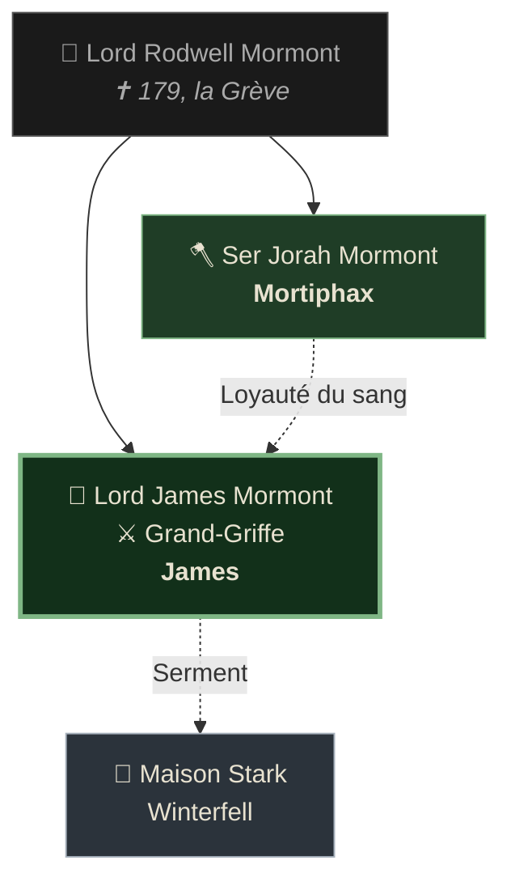

<div align="center">


<br/>


</div>

<br/>

<div align="center">

```
        ╔════════════════════════════════════════════════════╗
        ║                                                    ║
        ║      Sur un rocher de la Baie des Glaces,          ║
        ║      où le vent mord et où l'hiver ne finit        ║
        ║      jamais vraiment, un ours garde le Nord.       ║
        ║                                                    ║
        ║              — N O U S   V O I C I —               ║
        ║                                                    ║
        ╚════════════════════════════════════════════════════╝
```

</div>

---

## 🐻 ‹ I › La Maison

<table>
<tr>
<td width="50%" valign="top">

### 🛡️ Héraldique
| | |
|:--|:--|
| **Blason** | Ours noir rampant sur champ vert, cerclé d'une forêt verte |
| **Devise** | ***« Nous voici »*** |
| **Siège** | Le fort Mormont : longue salle de rondins, donjon enfumé et palissade de terre |
| **Terres** | L'Île-aux-Ours, Baie des Glaces |

</td>
<td width="50%" valign="top">

### ⚔️ Puissance
| | |
|:--|:--|
| **Allégeance** | Maison Stark de Winterfell |
| **Trésor** | ⚔️ **Grand-Griffe**, épée bâtarde valyrienne |
| **Force** | Guerriers et guerrières de l'île |
| **Ennemis** | 🦑 Les Fer-nés · Les sauvageons |

</td>
</tr>
</table>

> [!NOTE]
> L'Île-aux-Ours n'est ni riche ni peuplée. Mais chaque homme, chaque femme, chaque enfant y sait tenir une hache. **Ici, on ne compte pas les épées : on compte les ours.**

---

## 👑 ‹ II › Ceux qui portent le nom

<div align="center">

<table>
<tr>
<td align="center" width="50%">

### 🐻 LE SEIGNEUR


**Lord James Mormont**<br/>
<sub>Seigneur de l'Île-aux-Ours<br/>Chef de la Maison Mormont<br/>⚔️ Détenteur de Grand-Griffe</sub>

</td>
<td align="center" width="50%">

### 🪓 LE FRÈRE


**Ser Jorah Mormont**<br/>
<sub>Frère cadet du Seigneur<br/>Bouclier de l'île<br/>🛡️ Fléau des Fer-nés</sub>

</td>
</tr>
</table>

</div>

### 🌲 Arbre de la Maison



---

## 📖 ‹ III › Les Chroniques

<details>
<summary><b>👑 Lord James Mormont — <i>L'Ours qui veille</i></b> &nbsp; <code>Joueur : James</code></summary>

<br/>

> *« Une épée valyrienne ne fait pas un seigneur. Mais un seigneur qui la perd n'en est plus un. »*

Aîné de Lord Rodwell, tombé face aux Fer-nés en 179, il a reçu l'île, le fort et l'épée le même jour où il a mis son père en terre. Depuis, **Grand-Griffe** ne quitte jamais son côté. L'acier sombre aux reflets ondulés est l'unique trésor de la Maison, plus précieux que tout l'or que l'île n'a jamais eu.

Homme de devoir plus que de cour, il gouverne avec la rigueur qu'impose une terre où l'hiver ne pardonne pas la faiblesse. Il connaît chaque famille de l'île par son nom, et chaque famille sait qu'il marchera en tête quand les voiles noires des Fer-nés reviendront.

| Loyauté | Rigueur | Diplomatie | Combat |
|:--:|:--:|:--:|:--:|
| 🟩🟩🟩🟩🟩 | 🟩🟩🟩🟩⬛ | 🟩🟩⬛⬛⬛ | 🟩🟩🟩🟩⬛ |

</details>

<details>
<summary><b>🪓 Ser Jorah Mormont — <i>Le Cadet sans terre</i></b> &nbsp; <code>Joueur : Mortiphax</code></summary>

<br/>

> *« Mon frère a l'épée. Moi, j'ai mes poings, et ça m'a toujours suffi. »*

Né second, Jorah a grandi dans l'ombre de son frère, sans terre ni lame ancestrale à son nom. Alors il s'est fait un nom autrement : en 180, sur la Grève du Sang, il a tenu la plage avec trente hommes contre deux équipages fer-nés, et il a été adoubé sur le sable encore rouge.

Fidèle à son sang, il n'en reste pas moins un homme d'**ambition**. L'Île-aux-Ours est trop petite pour ses rêves, et le monde au-delà de la Baie des Glaces l'appelle.

| Loyauté | Ambition | Fierté | Combat |
|:--:|:--:|:--:|:--:|
| 🟩🟩🟩🟩⬛ | 🟩🟩🟩🟩🟩 | 🟩🟩🟩🟩🟩 | 🟩🟩🟩🟩🟩 |

</details>

---

## 🌍 ‹ IV › L'An 183

> [!WARNING]
> **Aegon IV** siège sur le Trône de Fer. Ses excès et ses innombrables bâtards déchirent la cour, et les grandes Maisons murmurent. Le royaume semble en paix, mais sous la neige, la glace craque.

Loin de Port-Réal, le Nord reste fidèle à ses dieux et à Winterfell. Les intrigues du Sud paraissent lointaines aux Mormont… mais un seigneur avisé sait qu'une tempête née dans la capitale finit toujours par atteindre les rivages du Nord.

---

## 🎯 ‹ V › Nos Ambitions

| | Objectif | Pourquoi |
|:--:|:--|:--|
| 🐺 | **Servir la Maison Stark** | Un serment Mormont ne se brise pas |
| 🌊 | **Tenir l'île face aux Fer-nés** | Chaque raid repoussé est une dette payée en sang |
| ⚔️ | **Préserver Grand-Griffe** | L'âme de la Maison tient dans cet acier |
| 💍 | **Tisser des alliances** | Sortir l'Île-aux-Ours de son isolement |
| 🔥 | **Faire vivre le lien des frères** | Loyauté du sang contre ambition du cadet |

---

## 🤝 ‹ VI › Diplomatie

<div align="center">

| Maison | Regard des Mormont |
|:--|:--:|
| 🐺 **Stark** |  |
| ❄️ **Maisons du Nord** |  |
| 🖤 **Garde de Nuit** |  |
| 🦑 **Fer-nés** |  |

</div>

---

## ✅ ‹ VII › Serment au Serveur

> [!IMPORTANT]
> En déposant cette candidature, la Maison Mormont s'engage :

- [x] 📜 Avoir lu et accepté le règlement du serveur
- [x] 📚 Respecter le lore et la chronologie de l'**an 183**
- [x] ⚖️ Jouer fair-play, avec comme contre les autres Maisons
- [x] 🔥 Être actifs et faire vivre la Maison

---

<div align="center">

### *Pour la Maison Mormont,*


<br/><br/>

**🐻 ‹ N O U S &nbsp; V O I C I › 🐻**


</div>
